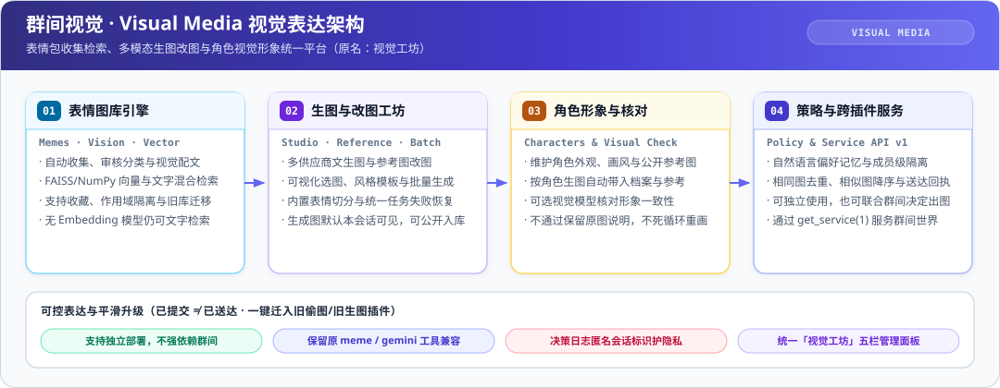

<div align="center">


# 群间视觉 · Visual Media

**群间系列视觉表达平台（原名「视觉工坊」）：一站式整合表情包收集检索、多模态生图改图、角色参考形象与媒体偏好策略。**


[](LICENSE)

[核心能力](#核心能力) · [系列联动](#与群间系列的联动) · [快速开始](#快速开始) · [群间系列生态](#群间系列生态) · [文档与许可](#进阶文档与许可)

</div>

---



## 核心能力

- **表情图库（Memes）**：支持聊天图片收集、人工审核分类、视觉模型自动配文、FAISS / NumPy 向量与文字混合检索（未配置 Embedding 模型仍可文字检索）、收藏与会话作用域管理。
- **生图与改图工坊（Studio）**：集成多供应商文生图、可视化参考图选图改图、批量生成、风格模板、表情切分、统一任务卡与失败恢复；生成图默认原会话可见，管理员可显式公开或收藏入表情库。
- **角色视觉形象与核对（Characters）**：统一维护固定角色的外观、画风与公开参考图；通过 `generate_character_image` 创作时自动带入角色档案，并支持可选视觉模型一致性核对（超时或不通过时保留原图说明，不死循环重画）。
- **媒体偏好策略与真实回执**：支持自然语言表达个人偏好（如「以后少发表情」「我喜欢水彩画风」「这张别再发了」），按完整会话与成员隔离；内置相同图去重、相似图降序、真实送达回执追踪（`generated` ≠ `delivered`）与匿名化决策日志。

## 与群间系列的联动

- **可独立运行，也可深度联动**：无需安装群间即可独立使用全部表情与生图能力；安装 **群间 · Chat Dynamics** 后，可在其获准回复的回合内自然联合选择文字、表情或生图。
- **开放跨插件生图服务**：向 **群间世界 · Dynamics World** 等伙伴提供 `get_service(api_version=1)` 公开生图接口与受限参考图目录授权，支撑角色风景与见闻画面分享。

## 快速开始

1. 在 AstrBot（`>=4.29.4,<5`，Python 3.12+）安装本插件；若曾启用旧 `astrbot_plugin_stealer` 或 `astrbot_plugin_gemini_image_generation`，请先停用再启用，避免重复注册命令与工具。
2. 在插件配置中按需填写视觉模型、Embedding 模型、生图供应商及媒体策略，打开 **「视觉工坊」** 五栏面板（总览 / 角色形象 / 表情图库 / 生图创作 / 表达与记录）管理素材与任务。
3. 如需从旧偷图或旧 Gemini 生图插件迁移历史数据，停用新旧插件后运行内置一致性迁移脚本：

```sh
python tools/migrate_legacy.py \
  --data-root /AstrBot/data/plugin_data \
  --config-root /AstrBot/data/config \
  --destination /AstrBot/data/plugin_data/astrbot_plugin_visual_media \
  --config-destination /AstrBot/data/config/astrbot_plugin_visual_media_config.json
```

### 常用指令与工具

- **指令**：`/视觉帮助` · `/meme menu` · `/meme status` · `/生图 描述` · `/改图 描述` · `/换风格` · `/快速 表情包` · `/切图`
- **原生工具**：`search_meme` · `send_meme` · `steal_meme` · `gemini_image_generation` · `gemini_image_batch` · `gemini_image_lookup` · `gemini_image_share` · `list_visual_characters` · `generate_character_image` · `save_generated_meme`

---

## 群间系列生态

| 插件 | 仓库与标识 | 核心定位 |
| --- | --- | --- |
| **群间 · Chat Dynamics** | [`astrbot_plugin_chat_dynamics`](https://github.com/ysyhlly/astrbot_plugin_chat_dynamics) | 核心对话调度层：碎发聚合、话题路由、参与决策与节奏交付 |
| **群间世界 · Dynamics World** | [`astrbot_plugin_dynamics_world`](https://github.com/ysyhlly/astrbot_plugin_dynamics_world) | 角色卡、世界书、双地图天气、持续生活与 3D 实况小屋 |
| **群间记忆 · Dynamics Memory** | [`astrbot_plugin_dynamics_memory`](https://github.com/ysyhlly/astrbot_plugin_dynamics_memory) | 长期记忆、混合召回、2D/3D 图谱与原文证据冲突审查 |
| **群间学习 · Dynamics Learning** | [`astrbot_plugin_dynamics_learning`](https://github.com/ysyhlly/astrbot_plugin_dynamics_learning) | 固定性格红线下的成员资料、黑话好感与可回滚审查学习 |
| **群间见闻 · Dynamics Horizons** | [`astrbot_plugin_dynamics_horizons`](https://github.com/ysyhlly/astrbot_plugin_dynamics_horizons) | 角色隔离外部信息源与书架、自主精读与分群待讨论话题 |
| **群间游戏 · Dynamics Games** | [`astrbot_plugin_dynamics_games`](https://github.com/ysyhlly/astrbot_plugin_dynamics_games) | 共读/约局/接龙/挑战/共创协作与四大群聊娱乐引擎 |
| **群间史记 · Dynamics Chronicle** | [`astrbot_plugin_group_chronicle`](https://github.com/ysyhlly/astrbot_plugin_group_chronicle) | 原文依据的长期群史卷册、人物传记与群文化梗沿革 |
| **群间视觉 · Visual Media**（当前） | [`astrbot_plugin_visual_media`](https://github.com/ysyhlly/astrbot_plugin_visual_media) | 表情收集检索、多模态生图改图与角色视觉形象管理 |

---

## 进阶文档与许可

- [发布说明](RELEASE_NOTES.md) · [更新日志](CHANGELOG.md) · [参考图与任务体验](docs/TASKS-AND-REFERENCES.md) · [配置示例](docs/config-example.json) · [跨插件服务协议](docs/upstream-generation/plugin-api.md)
- 交流与反馈：项目反馈群兼聊天群 QQ `203363132`
- 上游项目署名见 [THIRD_PARTY_NOTICES.md](THIRD_PARTY_NOTICES.md)；本项目遵循 [AGPL-3.0 License](LICENSE)。
